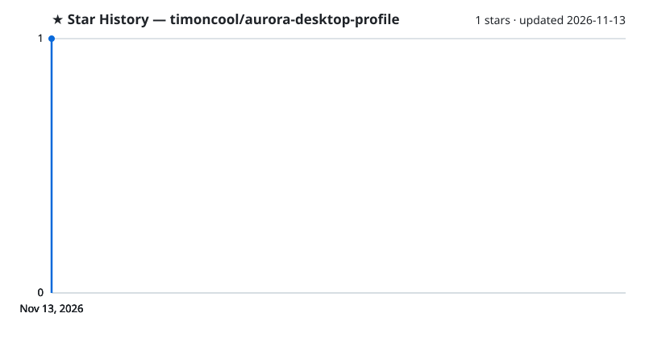

# Aurora Desktop Profile

**A desktop profile for Aurora: audio equalizer, shortcut hints, particles, key-press fade and a calm breathing background.**

**[English](README.md)** · **[Русский](README_RU.md)**

A desktop profile for [Aurora](https://github.com/Aurora-RGB/Aurora), the RGB lighting app for keyboards and mice. The keyboard follows your audio, hints keyboard shortcuts and breathes softly when nothing is going on. The profile is cleaned up: no leftover disabled layers and no broken ones. Tested on Aurora v384 with a full-size Razer DeathStalker V2 Pro on Windows 11.

## What's inside

Layers, top to bottom:

- **Key fade** — a pressed key flashes white and fades out
- **Particles** — soft light particles drift across the keyboard
- **Ctrl / Win / Alt Shortcuts** — hold a modifier: the background dims and the keys of known shortcuts light up (Ctrl red, Win blue, Alt yellow)
- **Equalizer** — 18 bands from 50 Hz to 10 kHz on the main block, scaled with the system volume
- **Equalizer - numpad** — the whole numpad block turns into its own equalizer while sound plays
- **Caps Lock blink** — letters blink while Caps Lock is on
- **Num Lock off** — the Num Lock key blinks orange while Num Lock is off
- **Mic muted** — Print Screen, Scroll Lock and Pause blink red while the microphone Aurora watches is muted (the Windows default recording device unless you pick another; if that default is a virtual mixer, choose the real microphone in Aurora's settings)
- **Sound muted** — the top row of the numpad (under the volume wheel) blinks orange while system sound is muted
- **Scroll Lock on** — the Scroll Lock key blinks blue while Scroll Lock is on
- **CPU Usage** — CPU load as a bar on F1–F12 (works when Aurora's hardware monitor sees the CPU)
- **Edge breathing / Main breathing** — two background zones breathe slowly in random colours
- **Volume Overlay** — a volume bar on F1–F12 for 3 seconds after the volume keys

## Install

1. **Close Aurora** (tray icon → exit), or it rewrites the profiles folder when it exits.
2. **Put `nerual-desktop.json`** into `%APPDATA%\Aurora\Profiles\desktop\`.
3. **Start Aurora** and pick "Nerual Desktop" among the desktop profiles.

## mpv profile

The [`mpv`](mpv) folder holds a profile for the mpv player: the keyboard goes dark and only the control keys stay lit — pause (Space, P) green, seek (arrows, PgUp/PgDn, `,` `.`) blue, volume (9, 0, M, numpad `/` `*`) orange, view (F, Esc, O, I, T) white, subtitles and audio (J, V, Z, X, 3) purple, speed (`[` `]` Backspace) yellow, screenshot (S) cyan, quit (Q) red.

Install: close Aurora, create `%APPDATA%\Aurora\AdditionalProfiles\mpv.exe\`, put `mpv/default.json` there together with a `settings.json` holding `{"IsEnabled": true, "SelectedProfile": "default"}`, start Aurora.

## With Nexus Fast

If your fans, pump, memory and motherboard run under [Nexus Fast](https://github.com/timoncool/nexus-service), hand the keyboard and mouse to Aurora from the lighting card menu ("Give to Aurora (RGB.NET)"). Aurora then sees and drives only those, Nexus drives the rest, and nobody overwrites anybody's colours.

## Other Projects by [@timoncool](https://github.com/timoncool)

| Project | Description |
|---|---|
| [Nexus Fast](https://github.com/timoncool/nexus-service) | A Nexus build for PC lighting, screens and cooling |
| [ScreenSavy.com](https://github.com/timoncool/ScreenSavy.com) | Ambient screen generator |
| [Bulka](https://github.com/timoncool/Bulka) | Live-coding music platform |
| [ACE-Step Studio](https://github.com/timoncool/ACE-Step-Studio) | AI music studio — songs, vocals, covers, videos |
| [telegram-api-mcp](https://github.com/timoncool/telegram-api-mcp) | Full Telegram Bot API as MCP server |

## Authors

- **Nerual Dreming** — [Telegram](https://t.me/nerual_dreming) | [neuro-cartel.com](https://neuro-cartel.com) | [ArtGeneration.me](https://artgeneration.me)

## Support the Author

I build open-source software and do AI research. Most of what I create is free and available to everyone. Your donations help me keep creating without worrying about where the next meal comes from =)

**[All donation methods](https://github.com/timoncool/ACE-Step-Studio/blob/master/DONATE.md)** | **[dalink.to/nerual_dreming](https://dalink.to/nerual_dreming)** | **[boosty.to/neuro_art](https://boosty.to/neuro_art)**

- **BTC:** `1E7dHL22RpyhJGVpcvKdbyZgksSYkYeEBC`
- **ETH (ERC20):** `0xb5db65adf478983186d4897ba92fe2c25c594a0c`
- **USDT (TRC20):** `TQST9Lp2TjK6FiVkn4fwfGUee7NmkxEE7C`

## Star History

<a href="https://github.com/timoncool/aurora-desktop-profile/stargazers">
 <picture>
   <source media="(prefers-color-scheme: dark)" srcset="docs/stars-dark.svg" />
   <source media="(prefers-color-scheme: light)" srcset="docs/stars-light.svg" />
   
 </picture>
</a>

## License

[MIT](LICENSE)
