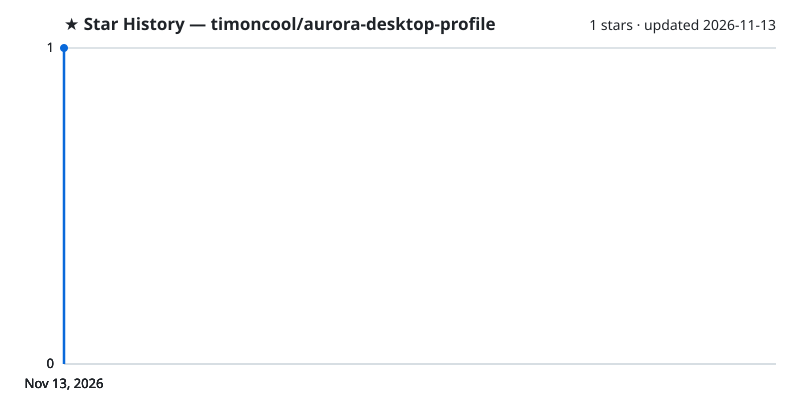

# Aurora Desktop Profile

**Профиль рабочего стола для Aurora: эквалайзер под звук, подсказки сочетаний, частицы, подсветка нажатий и спокойное дыхание фона.**

**[English](README.md)** · **[Русский](README_RU.md)**

Профиль рабочего стола для [Aurora](https://github.com/Aurora-RGB/Aurora) — программы RGB-подсветки клавиатур и мышей. Клавиатура слушает звук, подсказывает сочетания клавиш и мягко дышит, когда ничего не происходит. Профиль вычищен: никаких отключённых слоёв-хвостов и сломанных слоёв. Проверено на Aurora v384, полноразмерной клавиатуре Razer DeathStalker V2 Pro и Windows 11.

## Что внутри

Слои сверху вниз:

- **Key fade** — нажатая клавиша вспыхивает белым и гаснет
- **Particles** — светлые частицы медленно плывут по клавиатуре
- **Ctrl / Win / Alt Shortcuts** — зажали модификатор: фон гаснет, светятся клавиши известных сочетаний (Ctrl — красным, Win — синим, Alt — жёлтым)
- **Equalizer** — 18 полос от 50 Гц до 10 кГц на основном блоке, громкость системы учитывается
- **Equalizer - numpad** — свой эквалайзер на цифровом блоке
- **Caps Lock blink** — буквы мигают, пока включён Caps Lock
- **Num Lock off** — клавиша Num Lock мигает оранжевым, пока Num Lock выключен
- **Mic muted** — Print Screen, Scroll Lock и Pause мигают красным, пока микрофон по умолчанию заглушён
- **Sound muted** — Esc мигает оранжевым, пока звук системы заглушён
- **CPU Usage** — загрузка процессора полосой на F1–F12 (работает, если мониторинг железа в Aurora видит процессор)
- **Edge breathing / Main breathing** — две зоны фона медленно дышат случайными цветами
- **Volume Overlay** — полоса громкости на F1–F12 на 3 секунды после клавиш громкости

## Установка

1. **Закройте Aurora** (иконка в трее → выход), иначе при выходе она перезапишет папку профилей.
2. **Положите `nerual-desktop.json`** в `%APPDATA%\Aurora\Profiles\desktop\`.
3. **Запустите Aurora** и выберите профиль «Nerual Desktop» в профилях рабочего стола.

## Вместе с Nexus Fast

Если вентиляторы, помпа, память и материнка у вас под [Nexus Fast](https://github.com/timoncool/nexus-service), отдайте клавиатуру и мышь Aurora в меню карточки подсветки («Отдать Aurora (RGB.NET)»). Aurora будет видеть и вести только их, Nexus — всё остальное, и цвета никто не перебивает.

## Другие проекты [@timoncool](https://github.com/timoncool)

| Проект | Описание |
|---|---|
| [Nexus Fast](https://github.com/timoncool/nexus-service) | Сборка Nexus для подсветки, экранов и охлаждения ПК |
| [ScreenSavy.com](https://github.com/timoncool/ScreenSavy.com) | Генератор эмбиент-экранов |
| [Bulka](https://github.com/timoncool/Bulka) | Платформа лайв-кодинга музыки |
| [ACE-Step Studio](https://github.com/timoncool/ACE-Step-Studio) | AI-студия музыки — песни, вокал, каверы, клипы |
| [telegram-api-mcp](https://github.com/timoncool/telegram-api-mcp) | Telegram Bot API как MCP-сервер |

## Авторы

- **Nerual Dreming** — [Telegram](https://t.me/nerual_dreming) | [neuro-cartel.com](https://neuro-cartel.com) | [ArtGeneration.me](https://artgeneration.me)

## Поддержать автора

Я создаю опенсорс софт и занимаюсь исследованиями в области ИИ. Большая часть всего, что я делаю, находится в открытом доступе. Ваши пожертвования позволяют мне создавать и исследовать больше, не отвлекаясь на поиск еды для продолжения существования =)

**[Все способы поддержки](https://github.com/timoncool/ACE-Step-Studio/blob/master/DONATE.md)** | **[dalink.to/nerual_dreming](https://dalink.to/nerual_dreming)** | **[boosty.to/neuro_art](https://boosty.to/neuro_art)**

- **BTC:** `1E7dHL22RpyhJGVpcvKdbyZgksSYkYeEBC`
- **ETH (ERC20):** `0xb5db65adf478983186d4897ba92fe2c25c594a0c`
- **USDT (TRC20):** `TQST9Lp2TjK6FiVkn4fwfGUee7NmkxEE7C`

## Star History

<a href="https://github.com/timoncool/aurora-desktop-profile/stargazers">
 <picture>
   <source media="(prefers-color-scheme: dark)" srcset="docs/stars-dark.svg" />
   <source media="(prefers-color-scheme: light)" srcset="docs/stars-light.svg" />
   
 </picture>
</a>

## Лицензия

[MIT](LICENSE)
